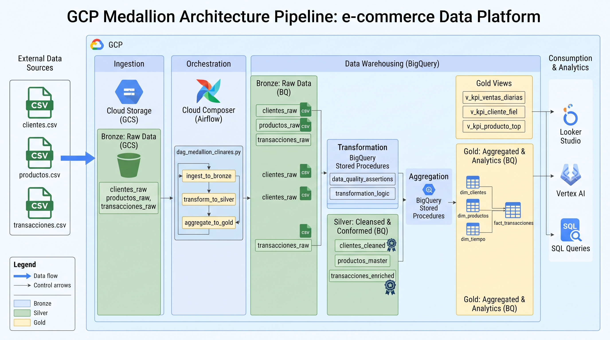
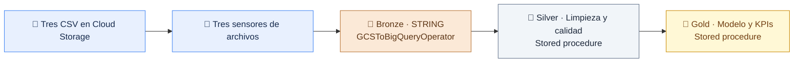

# 🏅 Arquitectura medallón · E-commerce

**De archivos CSV a indicadores de negocio con Cloud Composer y BigQuery.**


Laboratorio académico para recorrer el ciclo completo de datos: **ingestar → limpiar → modelar → analizar**. Un solo proyecto de Google Cloud y un Composer compartido, con recursos identificados por alumno.

[⚙️ Configurar](docs/01_configuracion.md) · [🚀 Desplegar](docs/02_despliegue.md) · [🧩 Entender el modelo](docs/03_arquitectura_modelo.md) · [🛠️ Operar](docs/04_operacion.md)

---

## 🗺️ Arquitectura de referencia



> [!NOTE]
> La imagen es una referencia conceptual ampliada. En este laboratorio, Cloud Storage es **landing** y las capas **bronze, silver y gold** residen en BigQuery. Las transformaciones se realizan con SQL y SP; Dataflow, Spark/Beam, Looker Studio y Vertex AI no forman parte de la implementación actual. Los nombres de tablas de la imagen son ilustrativos.

## 🔄 Flujo implementado



| Etapa | Qué ocurre | Responsable |
|---|---|---|
| 📥 Landing | Llegan clientes.csv, productos.csv y transacciones.csv | Cloud Storage |
| 🥉 Bronze | Se cargan los originales con todas las columnas STRING | Operadores de Airflow |
| 🥈 Silver | Se limpian y tipan entidades; se validan claves e importes | SP de BigQuery |
| 🥇 Gold | Se cargan dimensiones y hechos; se consultan KPIs | SP y vistas de BigQuery |

## 📚 Documentación

| Guía | Qué encontrarás |
|---|---|
| [⚙️ Configuración](docs/01_configuracion.md) | Recursos GCP, permisos, Variable JSON y ejemplo de alumno |
| [🚀 Despliegue paso a paso](docs/02_despliegue.md) | DDL y SP manuales, publicación del DAG y primera carga |
| [🧩 Arquitectura y modelo](docs/03_arquitectura_modelo.md) | Capas, tablas, relaciones, grano y métricas |
| [🛠️ Operación y errores](docs/04_operacion.md) | Modo automático, reintentos, reproceso y diagnóstico |

## 🎓 Tu identificador de alumno

> [!IMPORTANT]
> Reemplaza **clinares** por **la primera letra de tu nombre + tu primer apellido**, en minúsculas, sin espacios ni tildes. Usa el mismo identificador en DAG, datasets, procedimientos, Variable y carpeta de datos.

**Carlos Linares → clinares** · **María Torres → mtorres**

Consulta los nombres completos en [Ejemplo Alumno](docs/01_configuracion.md). Si dos identificadores coinciden, acuerda uno único con el docente.

## ☁️ Recursos del aula

| Recurso | Nombre | Acceso |
|---|---|---|
| Proyecto GCP | bsgroup-dev-test-1 | [Consola](https://console.cloud.google.com/home/dashboard?project=bsgroup-dev-test-1) |
| Composer | pe-composer-orchestrator-bsgroup | [Entornos](https://console.cloud.google.com/composer/environments?project=bsgroup-dev-test-1) |
| Bucket del código | pe-cs-orchestrator-bsgroup | [Carpeta dags](https://console.cloud.google.com/storage/browser/pe-cs-orchestrator-bsgroup/dags?project=bsgroup-dev-test-1) |
| Bucket de CSV | pe-cs-datalake-bsgroup | [Cloud Storage](https://console.cloud.google.com/storage/browser/pe-cs-datalake-bsgroup?project=bsgroup-dev-test-1) |
| Datasets | bronze_clinares · silver_clinares · gold_clinares | [BigQuery](https://console.cloud.google.com/bigquery?project=bsgroup-dev-test-1) |

Los enlaces de consola requieren acceso al proyecto. **US** corresponde a la ubicación BigQuery del ejemplo; la región de Composer se consulta en su entorno.

## 📂 Estructura del proyecto

```text
composer_medallon/
├── dags/                     # DAG para Composer
├── sql/                      # DDL y SP ejecutables en BigQuery
├── config/                   # Variable JSON de Airflow
├── data/                     # Tres CSV del ejercicio
├── docs/                     # Guías e imagen de arquitectura
├── verificar_local.py        # Comprobaciones sin conexión a GCP
├── requirements-local.txt
└── README.md
```

[🐍 Abrir DAG](dags/dag_medallon_clinares.py) · [🏗️ Abrir DDL](sql/00_ddl_consolidado_clinares.sql) · [🔧 Abrir SP](sql/01_sp_cargas_clinares.sql) · [⚙️ Abrir JSON](config/ecommerce_config_clinares.json)

## 🧭 Decisiones del ejercicio

- **Preparación manual:** los DDL y los SP se ejecutan en BigQuery antes de activar el flujo.
- **Bronze sin SP:** GCSToBigQueryOperator usa esquema STRING explícito y autodetect=False.
- **Barrera de archivos:** todas las cargas esperan a los tres sensores; silver espera a las tres cargas.
- **Configuración en ejecución:** Airflow lee una Variable JSON propia por alumno.
- **Fecha automática:** la carpeta YYYYMMDD proviene del inicio real del DAG en America/Lima; no incluir fecha_carga ni lote en el JSON.
- **Alcance académico:** una entrega diaria, cargas completas y dimensiones tipo 1; sin histórico incremental ni SCD2.

## ✅ Verificación local

Desde esta carpeta:

```powershell
python -m pip install -r requirements-local.txt
python verificar_local.py
```

La verificación comprueba CSV, reglas de origen, sintaxis Python, configuración, referencias de SP y el grafo mediante dobles locales de operadores.

> [!NOTE]
> Validar localmente no equivale a importar ni ejecutar el DAG en Composer. La prueba de aceptación en nube está en [Despliegue](docs/02_despliegue.md). Publicar el repositorio en GitHub tampoco despliega el DAG en Google Cloud.

---

**Siguiente paso:** [🚀 Desplegar la solución](docs/02_despliegue.md)
