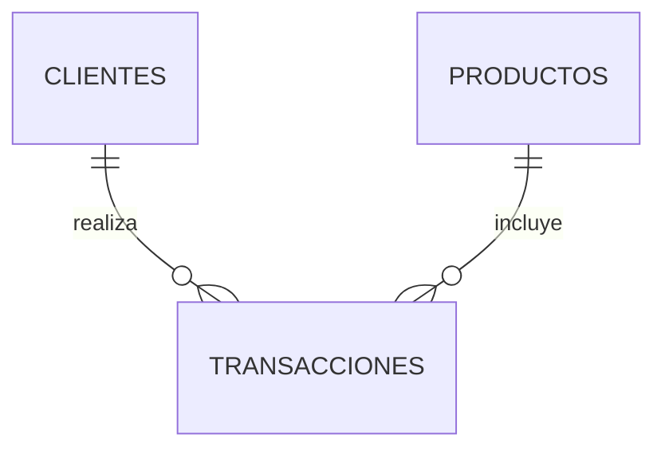
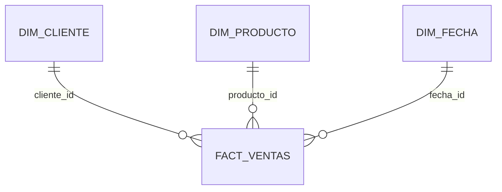

# 🧩 Arquitectura y modelo de datos

[🏠 Proyecto y arquitectura](../README.md)

## Responsabilidades

| Capa | Tecnología | Objetivo |
|---|---|---|
| Landing | Cloud Storage | CSV originales en landing/ALUMNO/YYYYMMDD/ |
| Bronze | BigQuery + GCSToBigQueryOperator | Ingesta sin conversiones: todas las columnas STRING |
| Silver | BigQuery SP | Normalización, tipos y controles de calidad |
| Gold | BigQuery SP y vistas | Modelo dimensional y métricas |

DDL manual antes de la ejecución. Solo silver y gold tienen SP. Cada carga bronze usa autodetect=False, CREATE_NEVER y WRITE_TRUNCATE; archivos exactos, sin comodines. Los tres sensores son una barrera antes de cargar. Las tres cargas pueden correr en paralelo y silver espera su éxito conjunto.

## Entidades silver

| Entidad | Clave | Columnas tipadas |
|---|---|---|
| clientes | cliente_id STRING | fecha_registro DATE, activo BOOL |
| productos | producto_id STRING | precio_unitario/costo_unitario NUMERIC, stock_actual INT64, disponible BOOL |
| transacciones | transaccion_id STRING | fecha_transaccion DATETIME, cantidad INT64, importes NUMERIC |

Teléfono conserva STRING. Las columnas de texto restantes se conservan como STRING. Definiciones completas: [DDL](../sql/00_ddl_consolidado_clinares.sql).

Silver aplica TRIM, vacíos a NULL, email en minúsculas, códigos en mayúsculas, SAFE_CAST y DISTINCT. Duplicados idénticos se eliminan; claves repetidas con valores diferentes provocan error. ASSERT valida obligatoriedad, unicidad, referencias, estados y coherencia de importes antes de COMMIT. No hay tabla de rechazados en esta versión.

## Estrella gold

Grano: una fila por transaccion_id, asociada a un cliente y un producto. Claves naturales cliente_id/producto_id; fecha_id entero YYYYMMDD. Dimensiones tipo 1, sin historial de atributos. Las relaciones son verificadas por SQL, no por restricciones de claves impuestas por BigQuery.

## Definición de indicadores

| Indicador | Regla |
|---|---|
| Ventas brutas | SUM(cantidad * precio_unitario) |
| Descuentos | SUM(descuento_monto) |
| Ventas netas | SUM(monto_total), expuesto como importe_neto en hechos |
| Transacciones completadas | COUNT(*) con estado COMPLETADO |
| Unidades vendidas | SUM(cantidad) con estado COMPLETADO |
| Ticket promedio | Ventas netas / transacciones completadas |
| Clientes compradores | COUNT(DISTINCT cliente_id) con estado COMPLETADO |

Las vistas de KPIs filtran COMPLETADO; fact_ventas conserva todos los estados. No sumar clientes distintos por día para obtener el total global ni promediar promedios diarios sin ponderación. No existe pedido_id: el ticket es por transacción, no por pedido.

## Fecha técnica y fecha de negocio

La carpeta técnica se calcula desde dag_run.start_date, convertida a America/Lima. No depende del JSON ni de fecha_transaccion. Si la ejecución cruza medianoche conserva su fecha inicial. Las fechas de transacción de los CSV no incluyen zona horaria y se conservan como DATETIME. Los archivos no identifican moneda; las sumas suponen una sola moneda que el negocio debe confirmar. No se calcula margen histórico con costo actual del catálogo.

## Consistencia y alcance

Bronze no es una transacción conjunta de tres tablas. Silver y gold tienen una transacción independiente por SP con DELETE + INSERT y controles antes del COMMIT. Si falla, se revierte esa capa; el flujo completo no constituye una transacción única. Las cargas son completas y no acumulan registros por fecha. La fecha de carpeta no es una partición histórica de los datos cargados.

---

[🏠 Proyecto y arquitectura](../README.md) · [⚙️ Configuración](01_configuracion.md) · [🚀 Despliegue](02_despliegue.md) · [🛠️ Operación](04_operacion.md)
